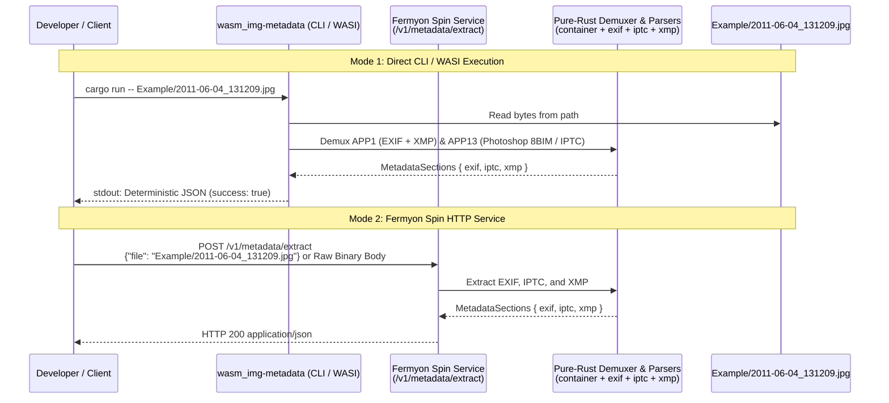

# Practical Example: Extracting EXIF, IPTC, and XMP Metadata (`2011-06-04_131209.jpg`)

This directory ([`./Example`](.)) contains a real-world photograph ([`2011-06-04_131209.jpg`](2011-06-04_131209.jpg)) captured in Xi'an, Shaanxi, China, embedding rich **EXIF** (including **GPS** coordinates and vendor tags), **IPTC-IIM** (location, keywords, copyright, UTF-8 caption), and **XMP** (`dc:*`, `exif:*`, `photoshop:*`, `Iptc4xmpCore:*`, `xmp:*`, `plus:*`) metadata.

It demonstrates how to extract all metadata using **`wasm_img-metadata`** via:
1. **CLI Execution** (native binary or WASI Preview 2 `wasmtime` sandbox)
2. **Fermyon Spin HTTP Service** (`POST /v1/metadata/extract` & `GET /v1/metadata/health`)

---

## Included Files

| File | Description |
| :--- | :--- |
| [`2011-06-04_131209.jpg`](2011-06-04_131209.jpg) | Real JPEG photograph (3264×2448, Casio EX-Z280) containing EXIF, GPS, PrintIM (`0xC4A5`), Microsoft padding (`0xEA1C`), IPTC-IIM (Record 1 & 2), and Adobe XMP RDF/XML packets. |
| [`README.md`](README.md) | This walkthrough covering CLI and Fermyon Spin HTTP usage. |

---

## Extraction Workflow



---

## 1. CLI Example (`Example/2011-06-04_131209.jpg`)

### A. Run via Cargo (Native Binary)

From the repository root, run:

```bash
cargo run --release -- Example/2011-06-04_131209.jpg
```

### B. Run inside a WASI Preview 2 Sandbox (`wasmtime`)

First build the `wasm32-wasip2` binary, then grant read access to `./Example`:

```bash
cargo build --bin wasm_img-metadata --target wasm32-wasip2 --release

wasmtime run --dir=Example::Example \
  target/wasm32-wasip2/release/wasm_img-metadata.wasm \
  Example/2011-06-04_131209.jpg
```

### C. Inspecting Extracted Metadata (Output Excerpt)

Because `wasm_img-metadata` never silently discards unknown or vendor-specific tags, the output includes all standard EXIF/GPS tags alongside Casio/Microsoft tags (`Tag_0xC4A5` PrintIM, `Tag_0xEA1C` padding, `Tag_0xEA1D`), all IPTC datasets, and all XMP properties:

```json
{
  "success": true,
  "file": "Example/2011-06-04_131209.jpg",
  "metadata": {
    "exif": {
      "Make": "CASIO COMPUTER CO.,LTD.",
      "Model": "EX-Z280",
      "CameraModel": "EX-Z280",
      "Orientation": 1,
      "XResolution": 72,
      "YResolution": 72,
      "ResolutionUnit": 2,
      "Software": "1.00",
      "DateTime": "2011-06-04T13:12:09",
      "YCbCrPositioning": 2,
      "Copyright": "ZHENG Robert",
      "ExposureTime": 0.002,
      "FNumber": 3.2,
      "ExposureProgram": 2,
      "ISOSpeedRatings": 64,
      "ExifVersion": "0221",
      "DateTimeOriginal": "2011-06-04T13:12:09",
      "DateTimeDigitized": "2011-06-04T13:12:09",
      "ExposureBiasValue": 0,
      "MaxApertureValue": 3.4,
      "MeteringMode": 5,
      "LightSource": 0,
      "Flash": 16,
      "FocalLength": 4.6,
      "FlashpixVersion": "0100",
      "ColorSpace": 1,
      "PixelXDimension": 3264,
      "PixelYDimension": 2448,
      "FileSource": 3,
      "CustomRendered": 0,
      "ExposureMode": 0,
      "WhiteBalance": 0,
      "DigitalZoomRatio": 0,
      "FocalLengthIn35mmFilm": 26,
      "SceneCaptureType": 0,
      "GainControl": 2,
      "Contrast": 0,
      "Saturation": 0,
      "Sharpness": 0,
      "Tag_0xC4A5": [80, 114, 105, 110, 116, 73, 77, 0, "..."],
      "Tag_0xEA1C": [28, 234, 0, 0, "..."],
      "Tag_0xEA1D": 4102,
      "InteropVersion": "0100",
      "GPSVersionID": [2, 2, 0, 0],
      "GPSLatitudeRef": "N",
      "GPSLatitude": [34, 12, 59.688],
      "GPSLongitudeRef": "E",
      "GPSLongitude": [108, 57, 50.904],
      "GPSAltitudeRef": 0,
      "GPSAltitude": 431,
      "GPSTimeStamp": [13, 12, 9],
      "GPSMapDatum": "WGS-84",
      "GPSDateStamp": "2011-06-04",
      "Compression": 6,
      "JPEGInterchangeFormat": 13616,
      "JPEGInterchangeFormatLength": 6490
    },
    "iptc": {
      "CodedCharacterSet": "\u001b%G",
      "ModelVersion": 4,
      "Keywords": [
        "Beichitou",
        "China",
        "CHN",
        "Shaanxi",
        "Xi'an"
      ],
      "DateCreated": "2011-06-04",
      "TimeCreated": "131209+0000",
      "City": "Xi'an",
      "Sub-location": "Beichitou",
      "Province-State": "Shaanxi",
      "Country-PrimaryLocationCode": "cn",
      "Country-PrimaryLocationName": "China",
      "CopyrightNotice": "ZHENG Robert",
      "RecordVersion": 4,
      "Caption-Abstract": "66号 Ci'en Road, Qujiang Shangquan, Yanta, Xi'an, Shaanxi, China, 710061"
    },
    "xmp": {
      "Iptc4xmpCore:CountryCode": "CHN",
      "Iptc4xmpCore:Location": "Beichitou",
      "MicrosoftPhoto:DateAcquired": "2011-06-06T20:07:18",
      "exif:DateTimeDigitized": "2011-06-04T13:12:09+00:00",
      "exif:DateTimeOriginal": "2011-06-04T13:12:09+00:00",
      "exif:GPSAltitude": "431/1",
      "exif:GPSAltitudeRef": 0,
      "exif:GPSLatitude": "34,12.994800N",
      "exif:GPSLongitude": "108,57.848400E",
      "exif:GPSMapDatum": "WGS-84",
      "exif:GPSTimeStamp": "2011-06-04T13:12:09Z",
      "exif:GPSVersionID": "2.2.0.0",
      "photoshop:City": "Xi'an",
      "photoshop:Country": "China",
      "photoshop:DateCreated": "2011-06-04T13:12:09+00:00",
      "photoshop:State": "Shaanxi",
      "photoshop:CountryCode": "cn",
      "photoshop:Continent": "[\"Asia\"]",
      "photoshop:Cca2": "CN",
      "photoshop:Cca3": "CHN",
      "photoshop:Capital": "[\"Beijing\"]",
      "photoshop:Timezone": "Asia/Shanghai",
      "xmp:BaseURL": "http://www.qingyi.de",
      "xmp:ModifyDate": "2011-06-04T13:12:09+00:00",
      "xmpMM:InstanceID": "uuid:faf5bdd5-ba3d-11da-ad31-d33d75182f1b",
      "dc:AddressEnglish": "710054 China, Shaanxi, Yanta District, Dayanta, unnamed road",
      "dc:AddressLocal": "710054 中国, 陕西省, 雁塔区, 大雁塔街道, unnamed road",
      "dc:CountryCode": "cn",
      "dc:rights": "ZHENG Robert",
      "dc:subject": [
        "Beichitou",
        "China",
        "CHN",
        "Shaanxi",
        "Xi'an"
      ],
      "dc:title": "2011-06-04 131209",
      "plus:CopyrightOwner": [
        "ZHENG Robert",
        "ZHENG Robert"
      ]
    }
  }
}
```

> [!TIP]
> You can filter specific sections on the command line using `jq`:
> ```bash
> # Query only IPTC and XMP sections
> cargo run --quiet -- Example/2011-06-04_131209.jpg | jq '{iptc: .metadata.iptc, xmp: .metadata.xmp}'
> ```

---

## 2. Fermyon Spin HTTP Service Example (`Example/2011-06-04_131209.jpg`)

The Spin manifest [`spin/spin.toml`](../spin/spin.toml) mounts the `./Example` directory into the WebAssembly component sandbox (`files = [{ source = "Example/", destination = "Example/" }]`) and exposes `/v1/metadata/...`.

### Step 1: Build and Start the Spin Application

From the repository root:

```bash
# Build the WASI Preview 2 Spin binary
cargo build --bin wasm_img_metadata_spin --target wasm32-wasip2 --release

# Start the Spin HTTP server (defaults to http://127.0.0.1:3000)
spin up --from spin/spin.toml
```

### Step 2: Check Service Health

```bash
curl -s http://127.0.0.1:3000/v1/metadata/health | jq .
```

Output:

```json
{
  "status": "ok",
  "service": "wasm-img-metadata-spin"
}
```

### Step 3: Extract Metadata by Referencing the Mounted File (JSON Request)

Because `Example/` is mounted inside the Spin component, you can send a JSON payload referencing `"Example/2011-06-04_131209.jpg"`:

```bash
curl -s -X POST http://127.0.0.1:3000/v1/metadata/extract \
  -H "Content-Type: application/json" \
  -d '{"file": "Example/2011-06-04_131209.jpg"}' | jq '{
    success: .success,
    file: .file,
    camera: .metadata.exif.CameraModel,
    gps_lat: .metadata.exif.GPSLatitude,
    gps_lon: .metadata.exif.GPSLongitude,
    iptc_keywords: .metadata.iptc.Keywords,
    xmp_title: .metadata.xmp["dc:title"],
    xmp_address_local: .metadata.xmp["dc:AddressLocal"]
  }'
```

Output:

```json
{
  "success": true,
  "file": "Example/2011-06-04_131209.jpg",
  "camera": "EX-Z280",
  "gps_lat": [
    34,
    12,
    59.688
  ],
  "gps_lon": [
    108,
    57,
    50.904
  ],
  "iptc_keywords": [
    "Beichitou",
    "China",
    "CHN",
    "Shaanxi",
    "Xi'an"
  ],
  "xmp_title": "2011-06-04 131209",
  "xmp_address_local": "710054 中国, 陕西省, 雁塔区, 大雁塔街道, unnamed road"
}
```

### Step 4: Extract Metadata by Uploading Raw Image Bytes

Clients can also stream the raw binary image directly in the HTTP `POST` body without mounting the file on the server:

```bash
curl -s -X POST http://127.0.0.1:3000/v1/metadata/extract \
  -H "Content-Type: image/jpeg" \
  -H "X-File-Name: 2011-06-04_131209.jpg" \
  --data-binary @Example/2011-06-04_131209.jpg | jq '.metadata.iptc'
```

Output:

```json
{
  "CodedCharacterSet": "\u001b%G",
  "ModelVersion": 4,
  "Keywords": [
    "Beichitou",
    "China",
    "CHN",
    "Shaanxi",
    "Xi'an"
  ],
  "DateCreated": "2011-06-04",
  "TimeCreated": "131209+0000",
  "City": "Xi'an",
  "Sub-location": "Beichitou",
  "Province-State": "Shaanxi",
  "Country-PrimaryLocationCode": "cn",
  "Country-PrimaryLocationName": "China",
  "CopyrightNotice": "ZHENG Robert",
  "RecordVersion": 4,
  "Caption-Abstract": "66号 Ci'en Road, Qujiang Shangquan, Yanta, Xi'an, Shaanxi, China, 710061"
}
```
