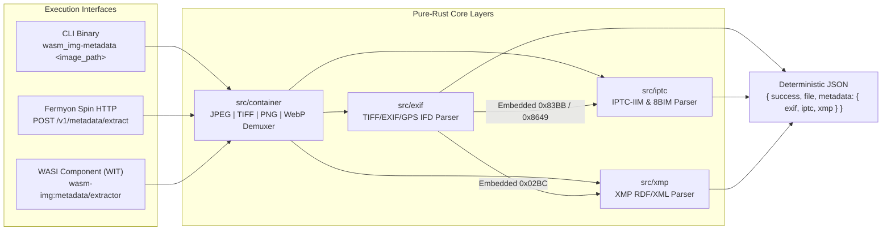

# `wasm_img-metadata` — Pure-Rust EXIF, IPTC & XMP Image Metadata Extractor (CLI, WASI & Fermyon Spin)

-654FF0?logo=webassembly)
-000000?logo=rust)


*[Deutsche Version dieser Dokumentation: README_de.md](README_de.md)*

`wasm_img-metadata` is a **pure-Rust** command-line application, **WASI Preview 2 Component (`wit`)**, and **Fermyon Spin HTTP Microservice** that extracts **all** available **EXIF**, **IPTC**, and **XMP** metadata from **JPEG**, **TIFF**, **PNG**, and **WebP** image files and outputs a single, deterministic JSON document.

It is engineered without any C/C++ bindings (`libexiv2` is not required), making it 100% memory-safe, portable, and ready to compile directly to native targets as well as `wasm32-wasip2`.

---

## Table of Contents

1. [Key Features & Extraction Rules](#key-features--extraction-rules)
2. [Architecture & Layering](#architecture--layering)
3. [Build & Compilation (Native, WASI & Fermyon Spin)](#build--compilation-native-wasi--fermyon-spin)
4. [Usage Mode 1: Command Line Interface (CLI & Wasmtime)](#usage-mode-1-command-line-interface-cli--wasmtime)
5. [Usage Mode 2: Fermyon Spin HTTP Microservice](#usage-mode-2-fermyon-spin-http-microservice)
6. [Usage Mode 3: WASI Preview 2 Component Model (`wit`)](#usage-mode-3-wasi-preview-2-component-model-wit)
7. [Practical Walkthrough (`./Example/2011-06-04_131209.jpg`)](#practical-walkthrough-example2011-06-04_131209jpg)
8. [JSON Output Contract & Error Handling](#json-output-contract--error-handling)
9. [Tests & Spec-Driven Development (`sdd`)](#tests--spec-driven-development-sdd)
10. [License & Notice](#license--notice)

---

## Key Features & Extraction Rules

- **100% Pure Stable Rust:** Built solely with `serde`, `serde_json`, and `flate2` (for compressed PNG `zTXt`/`iTXt` chunks). Compiles out of the box without system C/C++ libraries.
- **Multi-Container Support:**
  - **JPEG:** `APP1` EXIF, `APP1` XMP (`http://ns.adobe.com/xap/1.0/\0` and Extended XMP), `APP13` Photoshop IRB (`8BIM` resource `0x0404`, `0x0422`, `0x0424` and direct IPTC-IIM), and `COM` comments.
  - **TIFF:** Little-Endian (`II*\0`) and Big-Endian (`MM\0*`), traversing IFD0, IFD1, ExifIFD (`0x8769`), GPSIFD (`0x8825`), InteropIFD (`0xA005`), SubIFDs (`0x014A`), embedded IPTC (`0x83BB`), Photoshop IRB (`0x8649`), and embedded XMP (`0x02BC`).
  - **PNG:** `IHDR`, `eXIf`, `iTXt` (including `XML:com.adobe.xmp` and compressed UTF-8 text), `tEXt`, `zTXt`, `tIME`, `pHYs`, and raw hex profiles (`Raw profile type exif/iptc/8bim/xmp`).
  - **WebP:** RIFF `WEBP` containers with `EXIF`, `XMP `, `IPTC`/`PHOT`, and `VP8X` canvas dimensions.
- **Lossless Metadata Preservation (Never Silently Discards Tags):**
  - **Original Field Names:** Known tags map to their canonical field names (`Make`, `Model`, `CameraModel`, `DateTimeOriginal`, `GPSLatitude`, `Keywords`, `Caption-Abstract`, `dc:title`, `dc:subject`, etc.).
  - **Unknown Tags Emitted:** Unrecognized or proprietary tags are always preserved (`Tag_0xNNNN`, `GPSTag_0xNNNN`, `IPTC_<record>_<dataset>`, and full XMP namespace prefixes).
  - **Strict Type Fidelity:**
    - Repeatable fields and collections (`Keywords`, `dc:subject`, multi-value rationals like `GPSLatitude`) remain JSON arrays.
    - Numeric values (`SHORT`, `LONG`, `RATIONAL`, `FLOAT`, `DOUBLE`, XMP numbers) remain JSON numbers.
    - Dates (`YYYY:MM:DD HH:MM:SS` in EXIF/XMP, `YYYYMMDD` in IPTC, PNG `tIME`) are automatically normalized to **ISO-8601** strings (`YYYY-MM-DDTHH:MM:SS` or `YYYY-MM-DD`).
    - Missing metadata sections are always emitted as empty JSON objects (`"exif": {}`, `"iptc": {}`, `"xmp": {}`).
- **DoS & Memory Safety:** All binary offsets, slice bounds, cyclic IFD pointers, and zlib-compressed chunks (capped at 16 MiB) are strictly validated without panics.

---

## Architecture & Layering



The codebase follows the layered architecture enforced by [`constitution.md`](constitution.md) and [`sdd.config.yaml`](sdd.config.yaml):

| Layer | Module | Responsibility |
| :--- | :--- | :--- |
| **Container Demuxer** | [`src/container/mod.rs`](src/container/mod.rs) | Magic-byte detection and chunk extraction for JPEG, TIFF, PNG, and WebP |
| **EXIF / TIFF Parser** | [`src/exif/mod.rs`](src/exif/mod.rs) | Endian-aware IFD chain parser, rational arithmetic, ISO-8601 date conversion, unknown tag preservation |
| **IPTC-IIM Parser** | [`src/iptc/mod.rs`](src/iptc/mod.rs) | Record/Dataset decoding (`0x1C`), repeatable array aggregation (`Keywords`), ISO-8601 date normalization |
| **XMP RDF/XML Parser** | [`src/xmp/mod.rs`](src/xmp/mod.rs) | Namespace-preserving XML/RDF attribute & element extraction, `rdf:Bag`/`rdf:Seq`/`rdf:Alt` handling |
| **CLI & JSON Output** | [`src/cli/mod.rs`](src/cli/mod.rs), [`src/main.rs`](src/main.rs) | Single-argument `<image_path>` handling, file I/O, and JSON serialization (`SuccessResponse` / `ErrorResponse`) |
| **WIT & Spin Provider** | [`src/provider/mod.rs`](src/provider/mod.rs), [`src/provider/http.rs`](src/provider/http.rs), [`src/bin/wasm_img_metadata_spin.rs`](src/bin/wasm_img_metadata_spin.rs) | WASI Component Model (`wit/metadata-provider.wit`) and Fermyon Spin HTTP service (`spin/spin.toml`) |

---

## Build & Compilation (Native, WASI & Fermyon Spin)

### Prerequisites

- **Rust Toolchain** (stable `rustc` and `cargo`).
- For WebAssembly / WASI Preview 2 and Fermyon Spin builds:
  ```bash
  rustup target add wasm32-wasip2
  ```
- Optional runtimes: [`wasmtime`](https://wasmtime.dev/) for WASI CLI execution and [`spin`](https://developer.fermyon.com/spin) for the HTTP microservice.

### 1. Native Host Build

```bash
# Build optimized release binaries (CLI + Spin runner)
cargo build --release

# Compiled binaries:
# - target/release/wasm_img-metadata
# - target/release/wasm_img_metadata_spin
```

### 2. WASI Preview 2 (`wasm32-wasip2`) Build

```bash
# Build WASI CLI WebAssembly component
cargo build --bin wasm_img-metadata --target wasm32-wasip2 --release
# Artifact: target/wasm32-wasip2/release/wasm_img-metadata.wasm

# Build Fermyon Spin HTTP WebAssembly component
cargo build --bin wasm_img_metadata_spin --target wasm32-wasip2 --release
# Artifact: target/wasm32-wasip2/release/wasm_img_metadata_spin.wasm
```

### 3. Fermyon Spin Build

```bash
spin build --from spin/spin.toml
```

---

## Usage Mode 1: Command Line Interface (CLI & Wasmtime)

The CLI accepts a single command-line argument `<image_path>` and prints a single JSON document to `stdout`:

```bash
# Via Cargo
cargo run --release -- Example/2011-06-04_131209.jpg

# Or directly using the compiled native binary
./target/release/wasm_img-metadata Example/2011-06-04_131209.jpg

# Or inside a WASI Preview 2 sandbox via Wasmtime
wasmtime run --dir=Example::Example \
  target/wasm32-wasip2/release/wasm_img-metadata.wasm \
  Example/2011-06-04_131209.jpg
```

---

## Usage Mode 2: Fermyon Spin HTTP Microservice

The project includes a ready-to-run Fermyon Spin manifest at [`spin/spin.toml`](spin/spin.toml) exposing `/v1/metadata/...`.

### Starting the Spin Server

```bash
cargo build --bin wasm_img_metadata_spin --target wasm32-wasip2 --release
spin up --from spin/spin.toml
```

### HTTP Endpoints

1. **`GET /v1/metadata/health`** — Health Check:
   ```bash
   curl -s http://127.0.0.1:3000/v1/metadata/health
   # {"status":"ok","service":"wasm-img-metadata-spin"}
   ```

2. **`POST /v1/metadata/extract` (Option A — Raw Binary Image Upload):**
   Stream any JPEG, TIFF, PNG, or WebP file directly in the HTTP request body. Pass the filename via the `X-File-Name` header or `?file=` query string:
   ```bash
   curl -s -X POST http://127.0.0.1:3000/v1/metadata/extract \
     -H "Content-Type: image/jpeg" \
     -H "X-File-Name: 2011-06-04_131209.jpg" \
     --data-binary @Example/2011-06-04_131209.jpg
   ```

3. **`POST /v1/metadata/extract` (Option B — JSON File Path Reference):**
   Query a file mounted inside the Spin WASI sandbox (`Example/` is mounted by default in `spin/spin.toml`):
   ```bash
   curl -s -X POST http://127.0.0.1:3000/v1/metadata/extract \
     -H "Content-Type: application/json" \
     -d '{"file": "Example/2011-06-04_131209.jpg"}'
   ```

---

## Usage Mode 3: WASI Preview 2 Component Model (`wit`)

Other WASI components or Rust applications can invoke the extractor in-process via [`wit/metadata-provider.wit`](wit/metadata-provider.wit) and [`MetadataProvider`](src/provider/mod.rs):

```wit
package wasm-img:metadata@0.1.0;

interface extractor {
    extract-from-path: func(image-path: string) -> result<string, string>;
    extract-from-bytes: func(file-label: string, image-bytes: list<u8>) -> result<string, string>;
}

world metadata-provider {
    export extractor;
}
```

---

## Practical Walkthrough (`./Example/2011-06-04_131209.jpg`)

A complete step-by-step tutorial using the real photograph [`Example/2011-06-04_131209.jpg`](Example/2011-06-04_131209.jpg) (Casio EX-Z280 with GPS coordinates in Xi'an, IPTC keywords/location, and Adobe XMP) is available in **[`./Example/README.md`](Example/README.md)**.

---

## JSON Output Contract & Error Handling

### Success Output (`stdout` / HTTP 200)

```json
{
  "success": true,
  "file": "Example/2011-06-04_131209.jpg",
  "metadata": {
    "exif": {
      "Make": "CASIO COMPUTER CO.,LTD.",
      "Model": "EX-Z280",
      "CameraModel": "EX-Z280",
      "Orientation": 1,
      "DateTimeOriginal": "2011-06-04T13:12:09",
      "FNumber": 3.2,
      "ISOSpeedRatings": 64,
      "GPSLatitudeRef": "N",
      "GPSLatitude": [34, 12, 59.688],
      "GPSLongitudeRef": "E",
      "GPSLongitude": [108, 57, 50.904]
    },
    "iptc": {
      "Keywords": ["Beichitou", "China", "CHN", "Shaanxi", "Xi'an"],
      "DateCreated": "2011-06-04",
      "City": "Xi'an",
      "Country-PrimaryLocationName": "China",
      "CopyrightNotice": "ZHENG Robert"
    },
    "xmp": {
      "dc:title": "2011-06-04 131209",
      "dc:subject": ["Beichitou", "China", "CHN", "Shaanxi", "Xi'an"],
      "photoshop:City": "Xi'an",
      "photoshop:Timezone": "Asia/Shanghai"
    }
  }
}
```

### Error Output (`stdout` / HTTP 4xx)

Every error condition (missing CLI argument, non-existent file, corrupted header, unsupported format) returns valid JSON:

```json
{
  "success": false,
  "error": "Failed to read file 'missing.jpg': No such file or directory (os error 2)"
}
```

---

## Tests & Spec-Driven Development (`sdd`)

This repository is governed by Spec-Driven Development (`sdd`). Every acceptance criterion (`AC-1` through `AC-7`) in [`docs/prd/img-metadata.md`](docs/prd/img-metadata.md) is verified by automated tests in [`tests/metadata_integration.rs`](tests/metadata_integration.rs):

```bash
# Run all unit and integration tests (AC-1 .. AC-7)
cargo test

# Run SDD linter and pre-merge verification gate
sdd lint
sdd gate pre-merge
```

---

## License & Notice

Licensed under the **Apache License, Version 2.0**. See [`LICENSE`](LICENSE) and [`NOTICE`](NOTICE) for details.
