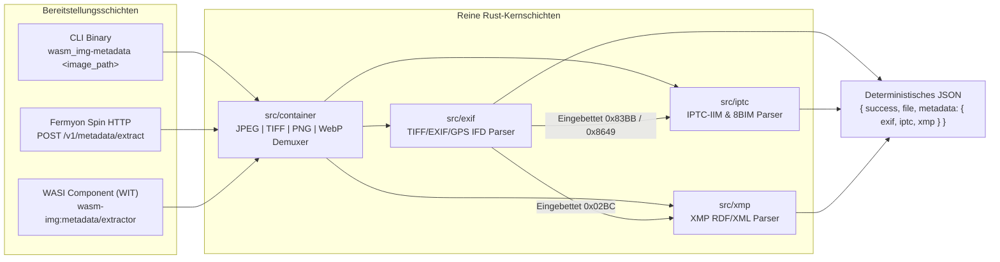

# `wasm_img-metadata` — Pure-Rust EXIF-, IPTC- & XMP-Bildmetadaten-Extraktor (CLI, WASI & Fermyon Spin)

-654FF0?logo=webassembly)
-000000?logo=rust)


*[English version of this documentation: README.md](README.md)*

`wasm_img-metadata` ist eine in **reinem, stabilem Rust** entwickelte Kommandozeilen-Anwendung, **WASI Preview 2 Komponente (`wit`)** und **Fermyon Spin HTTP-Microservice** zur verlustfreien Extraktion **sämtlicher** **EXIF-**, **IPTC-** und **XMP-Metadaten** aus **JPEG-**, **TIFF-**, **PNG-** und **WebP-Bilddateien** in ein einziges, deterministisches JSON-Dokument.

Die Anwendung kommt vollständig ohne externe C/C++-Bibliotheken (kein `libexiv2` erforderlich) aus, ist 100 % speichersicher und kompiliert ohne Anpassungen sowohl nativ als auch für `wasm32-wasip2`.

---

## Inhaltsverzeichnis

1. [Hauptmerkmale & Extraktionsregeln](#hauptmerkmale--extraktionsregeln)
2. [Architektur & Schichtenmodell](#architektur--schichtenmodell)
3. [Build & Kompilierung (Nativ, WASI & Fermyon Spin)](#build--kompilierung-nativ-wasi--fermyon-spin)
4. [Nutzungsmodus 1: Kommandozeile (CLI & Wasmtime)](#nutzungsmodus-1-kommandozeile-cli--wasmtime)
5. [Nutzungsmodus 2: Fermyon Spin HTTP Microservice](#nutzungsmodus-2-fermyon-spin-http-microservice)
6. [Nutzungsmodus 3: WASI Preview 2 Component Model (`wit`)](#nutzungsmodus-3-wasi-preview-2-component-model-wit)
7. [Praxisbeispiel (`./Example/2011-06-04_131209.jpg`)](#praxisbeispiel-example2011-06-04_131209jpg)
8. [JSON-Ausgabevertrag & Fehlerbehandlung](#json-ausgabevertrag--fehlerbehandlung)
9. [Tests & Spec-Driven Development (`sdd`)](#tests--spec-driven-development-sdd)
10. [Lizenz & Notice](#lizenz--notice)

---

## Hauptmerkmale & Extraktionsregeln

- **100 % reines, stabiles Rust:** Nutzt ausschließlich `serde`, `serde_json` und `flate2` (für komprimierte PNG-`zTXt`/`iTXt`-Chunks). Keine C/C++-Systemabhängigkeiten nötig.
- **Unterstützte Bildcontainer:**
  - **JPEG:** `APP1` EXIF, `APP1` XMP (`http://ns.adobe.com/xap/1.0/\0` sowie Extended XMP), `APP13` Photoshop IRB (`8BIM`-Ressourcen `0x0404`, `0x0422`, `0x0424` sowie direktes IPTC-IIM) und `COM`-Kommentare.
  - **TIFF:** Little-Endian (`II*\0`) und Big-Endian (`MM\0*`), inklusive Traversierung von IFD0, IFD1, ExifIFD (`0x8769`), GPSIFD (`0x8825`), InteropIFD (`0xA005`), SubIFDs (`0x014A`), eingebettetem IPTC (`0x83BB`), Photoshop IRB (`0x8649`) und eingebettetem XMP (`0x02BC`).
  - **PNG:** `IHDR`, `eXIf`, `iTXt` (inkl. `XML:com.adobe.xmp` und komprimierter UTF-8-Textblöcke), `tEXt`, `zTXt`, `tIME`, `pHYs` sowie Raw-Hex-Profile (`Raw profile type exif/iptc/8bim/xmp`).
  - **WebP:** RIFF-`WEBP`-Container mit `EXIF`, `XMP `, `IPTC`/`PHOT` und `VP8X`-Dimensionen.
- **Verlustfreie Metadaten-Abbildung (Kein stillschweigendes Verwerfen):**
  - **Originale Feldnamen:** Bekannte Tags behalten ihre kanonischen Originalnamen (`Make`, `Model`, `CameraModel`, `DateTimeOriginal`, `GPSLatitude`, `Keywords`, `Caption-Abstract`, `dc:title`, `dc:subject`, etc.).
  - **Unbekannte Tags werden ausgegeben:** Herstellerspezifische oder unbekannte Tags werden niemals verworfen (`Tag_0xNNNN`, `GPSTag_0xNNNN`, `IPTC_<record>_<dataset>` sowie vollständige XMP-Namespace-Präfixe).
  - **Originalgetreue Datentypen:**
    - Wiederholbare Felder und Sammlungen (`Keywords`, `dc:subject`, mehrteilige Rationals wie `GPSLatitude`) bleiben JSON-Arrays.
    - Numerische Werte (`SHORT`, `LONG`, `RATIONAL`, `FLOAT`, `DOUBLE`, XMP-Zahlen) bleiben JSON-Zahlen.
    - Datumsangaben (`YYYY:MM:DD HH:MM:SS` in EXIF/XMP, `YYYYMMDD` in IPTC, PNG `tIME`) werden automatisch in **ISO-8601**-Strings (`YYYY-MM-DDTHH:MM:SS` bzw. `YYYY-MM-DD`) konvertiert.
    - Fehlende Sektionen werden stets als leere JSON-Objekte ausgegeben (`"exif": {}`, `"iptc": {}`, `"xmp": {}`).
- **Speichersicherheit & DoS-Schutz:** Alle binären Offsets, Slice-Grenzen, zyklischen IFD-Pointer und Zlib-komprimierten Blöcke (begrenzt auf 16 MiB) werden strikt ohne `panic!` geprüft.

---

## Architektur & Schichtenmodell



Das Projekt ist gemäß der [Verfassung (`constitution.md`)](constitution.md) und [`sdd.config.yaml`](sdd.config.yaml) in klar getrennte Schichten gegliedert:

| Schicht | Modul | Verantwortung |
| :--- | :--- | :--- |
| **Container-Demuxer** | [`src/container/mod.rs`](src/container/mod.rs) | Magic-Byte-Erkennung und Extraktion der Roh-Metadatenblöcke für JPEG, TIFF, PNG und WebP |
| **EXIF / TIFF Parser** | [`src/exif/mod.rs`](src/exif/mod.rs) | Endian-sicherer IFD-Ketten-Parser, Rational-Arithmetik, ISO-8601-Datumsnormalisierung, Erhalt unbekannter Tags |
| **IPTC-IIM Parser** | [`src/iptc/mod.rs`](src/iptc/mod.rs) | Record/Dataset-Dekodierung (`0x1C`), Array-Aggregation für wiederholbare Felder (`Keywords`), ISO-8601-Daten |
| **XMP RDF/XML Parser** | [`src/xmp/mod.rs`](src/xmp/mod.rs) | Namespace-erhaltendes XML/RDF-Parsing für Attribute, Kind-Elemente und `rdf:Bag`/`rdf:Seq`/`rdf:Alt` |
| **CLI & JSON-Ausgabe** | [`src/cli/mod.rs`](src/cli/mod.rs), [`src/main.rs`](src/main.rs) | Verarbeitung des CLI-Arguments `<image_path>`, Datei-I/O und JSON-Serialisierung (`SuccessResponse` / `ErrorResponse`) |
| **WIT & Spin Provider** | [`src/provider/mod.rs`](src/provider/mod.rs), [`src/provider/http.rs`](src/provider/http.rs), [`src/bin/wasm_img_metadata_spin.rs`](src/bin/wasm_img_metadata_spin.rs) | WASI Component Model (`wit/metadata-provider.wit`) und Fermyon Spin HTTP-Service (`spin/spin.toml`) |

---

## Build & Kompilierung (Nativ, WASI & Fermyon Spin)

### Voraussetzungen

- **Rust Toolchain** (stabiles `rustc` und `cargo`).
- Für WebAssembly / WASI Preview 2 und Fermyon Spin:
  ```bash
  rustup target add wasm32-wasip2
  ```
- Optionale Laufzeitumgebungen: [`wasmtime`](https://wasmtime.dev/) für die WASI-CLI-Ausführung sowie [`spin`](https://developer.fermyon.com/spin) für den HTTP-Microservice.

### 1. Nativer Host-Build

```bash
# Optimierte Release-Binaries bauen (CLI + Spin-Runner)
cargo build --release

# Erzeugte Binaries:
# - target/release/wasm_img-metadata
# - target/release/wasm_img_metadata_spin
```

### 2. WASI Preview 2 (`wasm32-wasip2`) Build

```bash
# WASI CLI WebAssembly-Komponente bauen
cargo build --bin wasm_img-metadata --target wasm32-wasip2 --release
# Artefakt: target/wasm32-wasip2/release/wasm_img-metadata.wasm

# Fermyon Spin HTTP WebAssembly-Komponente bauen
cargo build --bin wasm_img_metadata_spin --target wasm32-wasip2 --release
# Artefakt: target/wasm32-wasip2/release/wasm_img_metadata_spin.wasm
```

### 3. Fermyon Spin Build

```bash
spin build --from spin/spin.toml
```

---

## Nutzungsmodus 1: Kommandozeile (CLI & Wasmtime)

Die CLI akzeptiert exakt ein Kommandozeilenargument `<image_path>` und gibt ein einzelnes JSON-Dokument auf `stdout` aus:

```bash
# Ausführung über Cargo
cargo run --release -- Example/2011-06-04_131209.jpg

# Oder direkt über das kompilierte native Binary
./target/release/wasm_img-metadata Example/2011-06-04_131209.jpg

# Oder isoliert in einer WASI Preview 2 Sandbox mit Wasmtime
wasmtime run --dir=Example::Example \
  target/wasm32-wasip2/release/wasm_img-metadata.wasm \
  Example/2011-06-04_131209.jpg
```

---

## Nutzungsmodus 2: Fermyon Spin HTTP Microservice

Das Repository enthält ein vollständiges Fermyon Spin Manifest unter [`spin/spin.toml`](spin/spin.toml), das die Route `/v1/metadata/...` bereitstellt.

### Spin-Server starten

```bash
cargo build --bin wasm_img_metadata_spin --target wasm32-wasip2 --release
spin up --from spin/spin.toml
```

### HTTP-Endpunkte

1. **`GET /v1/metadata/health`** — Health-Check:
   ```bash
   curl -s http://127.0.0.1:3000/v1/metadata/health
   # {"status":"ok","service":"wasm-img-metadata-spin"}
   ```

2. **`POST /v1/metadata/extract` (Variante A — Direkter Binär-Upload einer Bilddatei):**
   Beliebige JPEG-, TIFF-, PNG- oder WebP-Bytes direkt im HTTP-Body senden (Dateiname optional über Header `X-File-Name` oder Query `?file=`):
   ```bash
   curl -s -X POST http://127.0.0.1:3000/v1/metadata/extract \
     -H "Content-Type: image/jpeg" \
     -H "X-File-Name: 2011-06-04_131209.jpg" \
     --data-binary @Example/2011-06-04_131209.jpg
   ```

3. **`POST /v1/metadata/extract` (Variante B — JSON-Pfadreferenz auf gemountete Datei):**
   Referenziert eine in der Spin-Sandbox gemountete Datei (`Example/` ist in `spin/spin.toml` standardmäßig eingebunden):
   ```bash
   curl -s -X POST http://127.0.0.1:3000/v1/metadata/extract \
     -H "Content-Type: application/json" \
     -d '{"file": "Example/2011-06-04_131209.jpg"}'
   ```

---

## Nutzungsmodus 3: WASI Preview 2 Component Model (`wit`)

Andere WASI-Komponenten oder Rust-Anwendungen können den Extraktor direkt In-Process über [`wit/metadata-provider.wit`](wit/metadata-provider.wit) und [`MetadataProvider`](src/provider/mod.rs) aufrufen:

```wit
package wasm-img:metadata@0.1.0;

interface extractor {
    extract-from-path: func(image-path: string) -> result<string, string>;
    extract-from-bytes: func(file-label: string, image-bytes: list<u8>) -> result<string, string>;
}

world metadata-provider {
    export extractor;
}
```

---

## Praxisbeispiel (`./Example/2011-06-04_131209.jpg`)

Eine ausführliche Schritt-für-Schritt-Anleitung anhand der realen Beispieldatei [`Example/2011-06-04_131209.jpg`](Example/2011-06-04_131209.jpg) (Casio EX-Z280 Aufnahme aus Xi'an mit EXIF, GPS-Koordinaten, IPTC-Keywords und Adobe XMP) befindet sich unter **[`./Example/README.md`](Example/README.md)**.

---

## JSON-Ausgabevertrag & Fehlerbehandlung

### Erfolgsausgabe (`stdout` / HTTP 200)

```json
{
  "success": true,
  "file": "Example/2011-06-04_131209.jpg",
  "metadata": {
    "exif": {
      "Make": "CASIO COMPUTER CO.,LTD.",
      "Model": "EX-Z280",
      "CameraModel": "EX-Z280",
      "Orientation": 1,
      "DateTimeOriginal": "2011-06-04T13:12:09",
      "FNumber": 3.2,
      "ISOSpeedRatings": 64,
      "GPSLatitudeRef": "N",
      "GPSLatitude": [34, 12, 59.688],
      "GPSLongitudeRef": "E",
      "GPSLongitude": [108, 57, 50.904]
    },
    "iptc": {
      "Keywords": ["Beichitou", "China", "CHN", "Shaanxi", "Xi'an"],
      "DateCreated": "2011-06-04",
      "City": "Xi'an",
      "Country-PrimaryLocationName": "China",
      "CopyrightNotice": "ZHENG Robert"
    },
    "xmp": {
      "dc:title": "2011-06-04 131209",
      "dc:subject": ["Beichitou", "China", "CHN", "Shaanxi", "Xi'an"],
      "photoshop:City": "Xi'an",
      "photoshop:Timezone": "Asia/Shanghai"
    }
  }
}
```

### Fehlerausgabe (`stdout` / HTTP 4xx)

Jeder Fehlerfall (fehlendes CLI-Argument, nicht existierende Datei, beschädigter Header, nicht unterstütztes Format) liefert garantiertes, valides JSON:

```json
{
  "success": false,
  "error": "Failed to read file 'missing.jpg': No such file or directory (os error 2)"
}
```

---

## Tests & Spec-Driven Development (`sdd`)

Dieses Projekt wird nach Spec-Driven Development (`sdd`) entwickelt und geprüft. Jedes Akzeptanzkriterium (`AC-1` bis `AC-7`) in [`docs/prd/img-metadata.md`](docs/prd/img-metadata.md) ist durch automatisierte Tests in [`tests/metadata_integration.rs`](tests/metadata_integration.rs) abgedeckt:

```bash
# Alle Unit- und Integrationstests ausführen (AC-1 .. AC-7)
cargo test

# SDD-Linter und Pre-Merge-Gate prüfen
sdd lint
sdd gate pre-merge
```

---

## Lizenz & Notice

Lizenziert unter der **Apache License, Version 2.0**. Details siehe [`LICENSE`](LICENSE) und [`NOTICE`](NOTICE).
